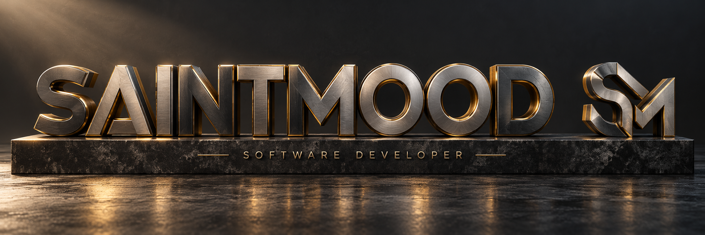
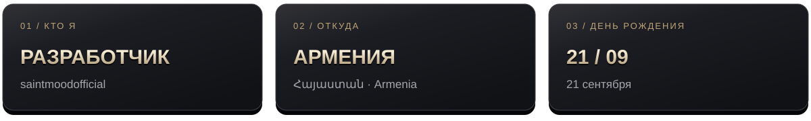
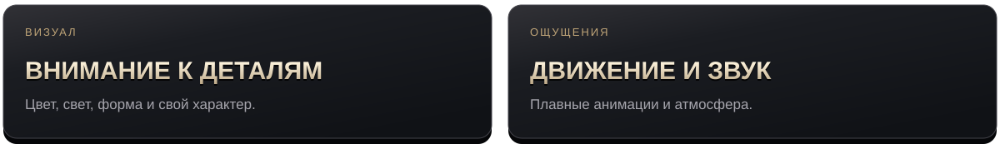
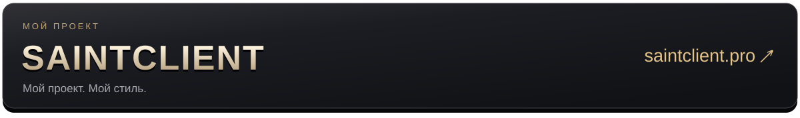

  

<b>SAINTMOOD</b> &nbsp; / &nbsp; PERSONAL SPACE

## Обо мне

Я разработчик из Армении. Родился **21 сентября**.

Здесь я под ником **saintmoodofficial**. Работаю над своими проектами и уделяю внимание тому, как они выглядят и ощущаются.

 

  

## В моём стиле

Люблю объёмный визуал, плавное движение и аккуратные детали. Хочу, чтобы у моих работ был свой характер.

  

## Над чем работаю

  

## Где меня найти

  <a href="https://github.com/saintmoodofficial"><b>GitHub / saintmoodofficial</b></a> 
  <a href="https://saintclient.pro"><b>SAINTCLIENT / saintclient.pro ↗</b></a>

---

SAINTMOOD &nbsp; · &nbsp; ARMENIA &nbsp; · &nbsp; SEPTEMBER 21

