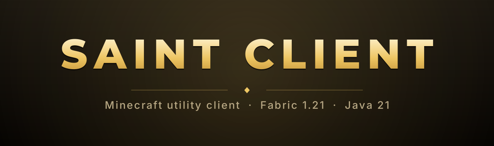

  

<h1 align="center">saint_mood</h1>

  Основатель и ведущий разработчик <b>SAINT CLIENT</b>

---

## Проект

**SAINT CLIENT** — утилитный клиент для Minecraft, который я развиваю как продукт: с собственным
интерфейсом, лаунчером и циклом обновлений.

Задача — сделать клиент, который не стыдно поставить рядом с коммерческими решениями: предсказуемая
производительность, выверенный интерфейс и понятный пользователю продукт, а не набор функций.

  
  
  

## Подход

- **Производительность — требование, а не пожелание.** Интерфейс обязан держать кадр в любых условиях.
- **Интерфейс проектируется, а не собирается.** Типографика, иконки и анимация — часть продукта.
- **Решения принимаются по замерам.** Причина находится и устраняется, а не маскируется.
- **Продукт закончен тогда, когда им удобно пользоваться.** Не тогда, когда он работает.

## Развитие

Ближайшее направление — расширение клиента, развитие лаунчера и выстраивание регулярных релизов.
Долгосрочная цель — устойчивый продукт с собственной аудиторией и репутацией.

## Статистика

  
  

---

  SAINT CLIENT не относится к Mojang Studios и Microsoft.

