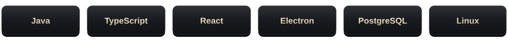

  

<h3 align="center">Разработчик продуктов на Java и TypeScript</h3>

  Основатель и разработчик <b>SAINTCLIENT</b>. 
  Создаю игровые клиенты, десктопные приложения и веб-платформы. 
  Проектирую архитектуру, пишу код и довожу продукт до выпуска.

  <a href="https://saintclient.pro"><b>saintclient.pro ↗</b></a>

 

  

### Разработка

**Клиенты и приложения** — Java, Fabric, Electron. Логика, интеграции и производительность.

**Интерфейсы** — TypeScript и React. Собственный визуальный стиль, анимации и удобное управление.

**Сервисы и релизы** — API, PostgreSQL и Linux. Авторизация, обновления и развёртывание.

 

SAINTMOOD · SOFTWARE DEVELOPMENT · © 2026

